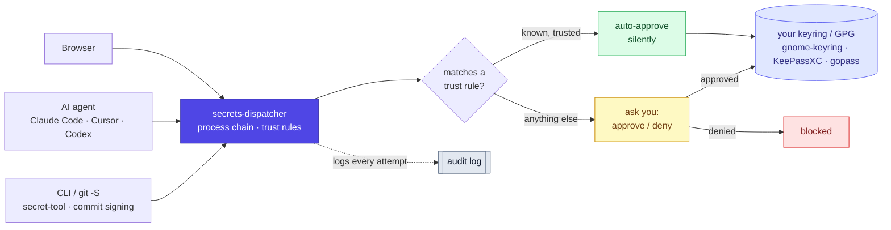

# Architecture

secrets-dispatcher is a proxy that speaks the freedesktop
[Secret Service](https://specifications.freedesktop.org/secret-service/) protocol
on both sides. It registers as the keyring so applications talk to it unchanged,
and behind it sits your real backend (gnome-keyring, KeePassXC, gopass…). The
same approval pipeline also gates `git commit -S` GPG signing.

## How a request is decided

Every secret access — and every signing request — passes through one decision:
if the caller (matched on its full process chain) hits a trust rule, it's
auto-approved silently; otherwise you're asked. Either way it's logged.



The intent is that after the first-week setup — auto-approve rules for the tools
you trust — the dispatcher goes quiet, prompting only for the unknown.

## Process chain detection

When a request arrives, secrets-dispatcher resolves the **full process
ancestry** of the caller, not just the immediate D-Bus sender:

```
Request: GetSecrets → collection/login/github-token
Process chain: claude-code → node → dbus-send
Unit: user@1000.service
```

That's what lets a rule match on the process that actually initiated the
request — distinguishing "Firefox wants my GitHub token" from
"unknown-script → curl → dbus-send wants my GitHub token." Trust rules match
anywhere in this chain; see [TRUST-RULES.md](TRUST-RULES.md) for the rule syntax
and which identifiers can and can't be spoofed.

## Audit logging

Every access attempt — approved, denied, or auto-ruled — is written to stderr as
one line of key=value fields, which systemd-journald keeps when the dispatcher
runs as the user service. The journal adds its own timestamp:

```
INF dbus_call client=local method=GetSecrets result=ok items=[/org/freedesktop/secrets/collection/login/12]
```

`serve --log-format json` (or `serve.log_format: json`) writes one JSON object
per line instead.

## Command line and settings

Each command resolves its settings once, at the edge, in three layers: a flag
that the user gives wins over the config file, and the config file wins over
the program's defaults. A setting's zero value means unset in both layers. A
flag left at its zero value does not override the file, and
`Config.WithDefaults` fills every setting that neither layer sets. Because a
zero flag already means unset, the flags merge over the file with `cmp.Or`, and
no kong resolver is needed. A setting whose zero value is a choice, such as
`notifications: false`, is a pointer in `Config`, where nil means unset.
`Config.WithDefaults` returns `Settings`, where every setting is a plain value,
so the code that runs a command never checks for an unset one.

The command line is parsed with [kong](https://github.com/alecthomas/kong). The
settings keep their own types, such as `config.LogLevel`, `config.Path` and
`service.Mode`. Each type decodes a flag and a config-file value through its
`encoding.TextUnmarshaler`.

## Service setup

`service install`, `service uninstall`, `service status` and `try` drive the
user's systemd manager over its D-Bus API, through
[go-systemd](https://github.com/coreos/go-systemd), and do not run `systemctl`.
A dry run still prints each manager call as the `systemctl --user` command that
does the same, and each session bus call as the `busctl --user` command that
does the same, for people to read. The companion's PAM hook stays a
`systemctl --user --machine=…` command line, because pam_exec runs a program.

An install is planned as a list of steps. Each step holds a change, as the dry
run prints it, and the call that makes that change. `service install` runs the
list that `service install --dry-run` prints, so the two cannot list different
changes.

The backend unit sets `DBUS_SESSION_BUS_ADDRESS` to the private backend bus only
for a backend that needs the variable to find that bus. gnome-keyring needs it.
A backend given as a command line gets it too, because its program is not known
to take the bus any other way. gopass-secret takes the bus as a flag, so the
variable keeps pointing at the session bus for its children. That matters
because gpg-agent starts pinentry with the `DBUS_SESSION_BUS_ADDRESS` that gpg
passes it, and pinentry must reach the desktop's prompter on the session bus.

## Scope

secrets-dispatcher runs as your user and adds **visibility and control**, not a
privilege boundary — it gates the keyring and GPG signing, not `.env` files or
arbitrary disk reads. See [SECURITY.md](../SECURITY.md) for the threat model.

## Diagram source

The README's architecture diagram is generated from
[`diagram/architecture.html`](diagram/architecture.html); re-render with:

```bash
chromium --headless=new --force-device-scale-factor=2 \
  --screenshot=docs/diagram/architecture.png --window-size=1000,400 \
  docs/diagram/architecture.html
```
